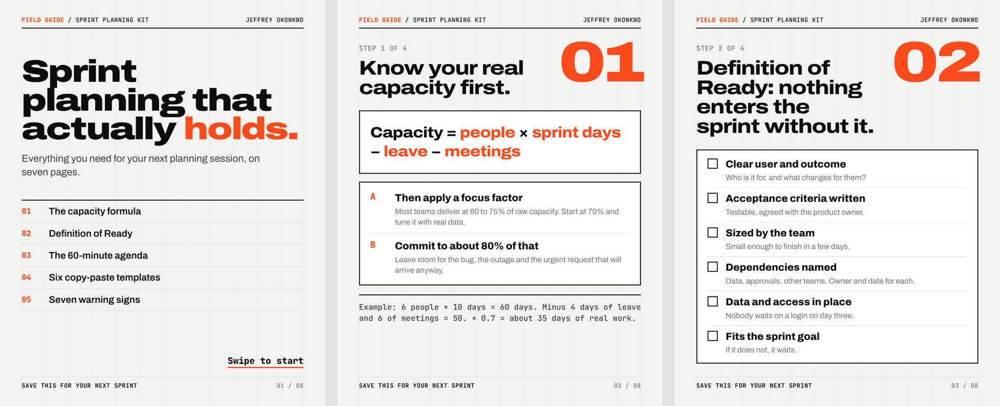
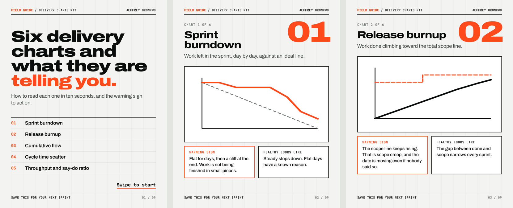

# Agile Delivery Field Guides

Two free, print-friendly guides for delivery managers, Scrum Masters and project managers. Each one fits on a phone screen, works as a LinkedIn carousel, and can be printed for a planning session.

## Sprint Planning Field Guide (8 pages)

[Download the PDF](Sprint_Planning_Field_Guide.pdf)

- The capacity formula, with a worked example
- A Definition of Ready checklist
- A 60-minute planning agenda, minute by minute
- Six copy-paste templates: sprint goal, user story, acceptance criteria, saying no with a trade-off, blocker escalation, and a three-question stand-up
- Seven warning signs that a sprint plan will break

## Delivery Charts Field Guide (9 pages)

[Download the PDF](Delivery_Charts_Field_Guide.pdf)

- Sprint burndown, release burnup, cumulative flow, cycle time scatter, throughput and say-do ratio
- For each chart: what it shows, the warning sign to act on, and what healthy looks like
- A one-page cheat sheet matching each chart to the question leadership is asking

## Free to use

Share, print or adapt them for your team. A credit to Jeffrey Okonkwo is appreciated.
