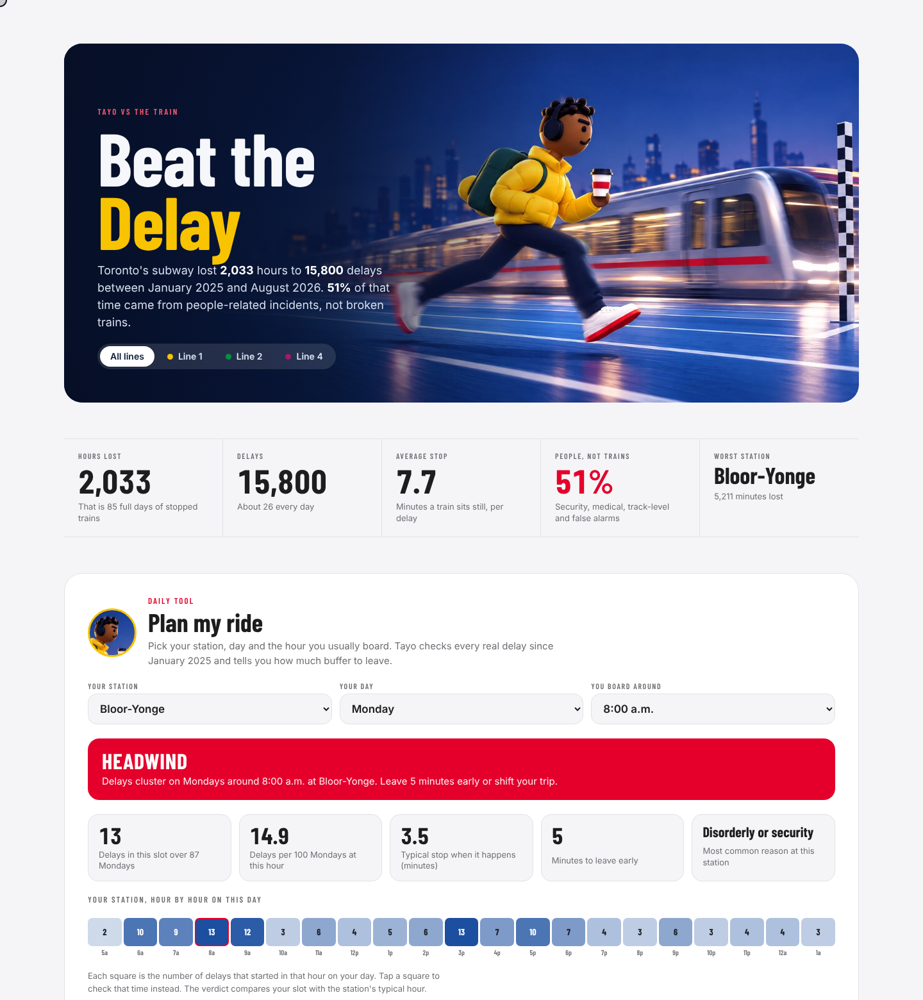
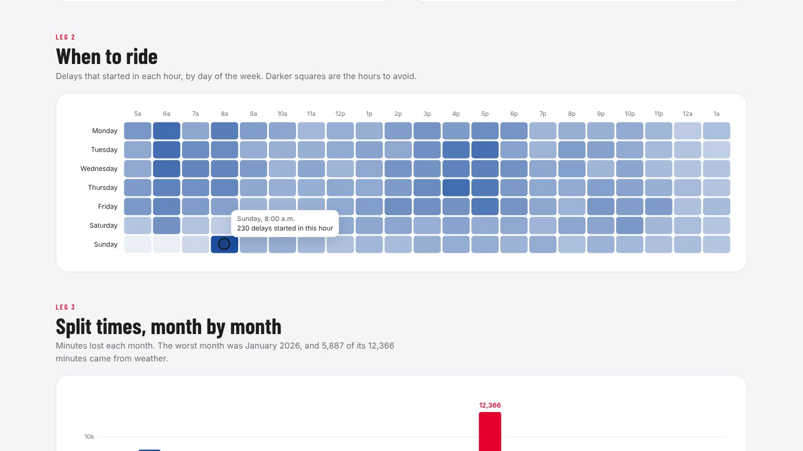

# Beat the Delay

**Every Toronto subway delay since January 2025, turned into a tool a rider can use every morning.**


Toronto's subway lost **2,033 hours** to **15,800 delays** between January 2025 and August 2026.
I wanted to know where that time goes, and whether an ordinary rider could do anything about it.

**Watch the 60-second walkthrough:** [assets/Beat_the_Delay_walkthrough.mp4](assets/Beat_the_Delay_walkthrough.mp4)
**Try the dashboard:** download [`dashboard.html`](dashboard.html) and open it in any browser (no install, data built in).

## The problem

Delay data is published every month, but it arrives as 45,000 raw log lines with 140 internal codes and
more than 1,200 spellings of station names. Nobody can read it, so nobody uses it.

## Two problems it helps solve

| For | Decision | What the data says |
|---|---|---|
| **The TTC** (planners, station managers) | Where would an extra staff hour save the most rider time? | People-related incidents cause 51% of lost minutes. Eight stations (Bloor-Yonge, St George, Finch, Kennedy, Spadina, Lawrence, Union, Kipling) hold a quarter of them, and nearly half fall between 3 and 11 p.m. Bloor-Yonge from 3 to 7 p.m. ranks first. |
| **Riders** | When should I leave, and how much buffer do I need? | Plan My Ride checks every delay at your station, day and hour and returns a verdict plus minutes to leave early. |

### Would more staff help?

Honestly, the evidence is mixed, and this data can point to staffing but cannot prove it works.

- **Security incidents:** after the TTC added police, guards and ambassadors in 2023 and 2024, offences per million boardings fell, but by August 2025 they were back near 2023 levels. No public report links staffing to fewer delay minutes.
- **Track-level incidents:** these average 17.6 minutes, the longest of any cause. Platform edge doors cut falls and suicides sharply in Hong Kong and Korea; the TTC paused its pilot in 2025 over cost.
- **Medical calls:** one in four runs past 10 minutes. Faster first response (New York posts EMTs at busy stations) targets that long tail.

**Recommended next step:** a measured pilot at Bloor-Yonge from 3 to 7 p.m., comparing delay minutes before and after against similar stations.

## What the data says

| Finding | What it means for a rider |
|---|---|
| **51%** of lost time comes from people-related incidents (security, medical calls, people on the tracks, false alarms), not broken trains | Faster medical response and more station staff would win back more time than train repairs alone |
| Weekday rush hours have **28% more delays per hour** than midday | If your schedule is flexible, ride between 10 a.m. and 3 p.m. |
| The riskiest hour of the week is **Sunday 8 a.m.**, when Sunday service starts, followed by **6 a.m. on weekdays** | The first trains of the day are the least reliable; leave a buffer |
| Sundays have the fewest delays but the **longest stops: 10.4 minutes** on average | Budget extra time on Sundays |
| Half of all delays end within **5 minutes** | A five-minute buffer beats most delays |
| **Bloor-Yonge** loses more time than any other station, mostly between 3 and 6 p.m. on weekdays | Evening transfers there need the biggest buffer |
| Alarms where nothing was wrong cost **131 hours** | Passenger alarm education is a cheap fix |
| A two-day snowstorm (25 and 26 January 2026) caused about **5,300 minutes** of delays | Weather is rare but brutal |

## The solution: Plan My Ride

Pick your station, day and the hour you board. The tool checks every real delay in that slot and returns a verdict:
**Green light**, **Steady pace** or **Headwind**, plus how many minutes to leave early.




## How it is built

```
City of Toronto Open Data (monthly)
        |
        v
pipeline/clean_ttc_delays.py   download, filter, standardise 1,251 station spellings to 70 stations,
        |                      group 140 delay codes into 10 plain-English causes
        v
data/ttc_subway_delays_2025_2026.csv  +  station_map.csv  +  cause_code_map.csv   (every decision auditable)
        |
        +--> excel/Beat_the_Delay_TTC.xlsx    live SUMIFS and COUNTIFS model, Race Day dashboard, Plan My Ride tool
        +--> powerbi/                          star schema, DAX measures, theme, Power Query that refreshes from this repo
        +--> interactive web dashboard         line filter, hover detail, sortable results board, trip planner
```

| Skill shown | Where |
|---|---|
| Requirements and problem framing | One decision per view: where does time go, and when should I ride |
| Data cleaning and governance | `pipeline/`, mapping tables published alongside the data |
| Data modelling | Star schema in `powerbi/`, one fact table and five dimensions |
| DAX and Excel modelling | `powerbi/measures.dax`, the Splits tab of the workbook |
| Visual design and storytelling | Race theme, one accent colour for the one message that matters |

## Run it yourself

```bash
pip install pandas requests openpyxl
python pipeline/clean_ttc_delays.py     # pulls the latest month and rebuilds the data files
```

Power BI: follow [`powerbi/POWERBI_GUIDE.md`](powerbi/POWERBI_GUIDE.md). Expected totals with no filters:
2,033 hours, 15,800 delays, 7.7 minute average stop, 51% people-related.

## Notes and limits

- Delays of zero minutes (logged events that did not stop a train) are excluded.
- Counts show where delays are reported, not ridership; a busy station will log more.
- The cause grouping is my own and is listed in full in `data/cause_code_map.csv`.

## Data and credits

TTC Subway Delay Data (since 2025), [City of Toronto Open Data](https://open.toronto.ca/dataset/ttc-subway-delay-data/),
Open Government Licence, Toronto. Not affiliated with or endorsed by the TTC.
Tayo is an original character created for this project.

Built by **Jeffrey Okonkwo**, Senior Business Analyst and Agile Delivery Manager, CBAP, CSM, PL-300.
