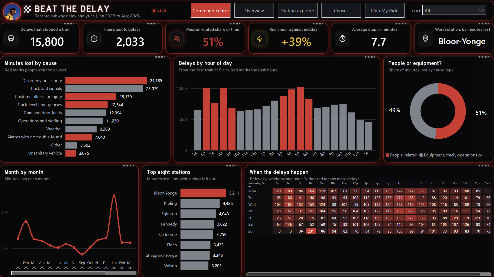

# Power BI: Beat the Delay

A finished Power BI project: four designed pages on a dark race-night theme, a star-schema model with 32 DAX measures, and Power Query that loads straight from this GitHub folder. You open it; you do not build it.



## Open it (Windows, or Windows on your Mac)

1. **Merge the GitHub branch first.** The model loads its data from `main`, so the files must be there.
2. Install **Power BI Desktop** from the Microsoft Store (free).
3. In Power BI Desktop: **File > Options and settings > Options > Preview features**, tick **Power BI Project (.pbip) save option** and **Store reports using enhanced metadata format (PBIR)** if they are listed, then restart. Newer versions have these on by default.
4. Download this repository (green **Code** button > **Download ZIP**), unzip it, and open `beat-the-delay/powerbi/project/BeatTheDelay.pbip`.
5. Click **Refresh**. If asked how to connect to GitHub, choose **Anonymous** and privacy level **Public**.

To work offline or from another folder, change the **DataRoot** parameter (Transform data > Manage parameters).

## Pages

| Page | What it answers | Visuals |
|---|---|---|
| Overview | Where does the lost time go? | Tayo hero, KPI cards (delays, hours lost, people-related share, weekday rush uplift), minutes lost by cause (people-related in red), delays by hour from the first train (rush hours in red), top eight stations |
| Station explorer | Which station, and when? | Line, station and period slicers, full station ranking (the worst in red), weekday by hour heatmap (a matrix coloured by the Heat Colour measure), minutes lost by month (the worst month in red), hours lost and average stop cards |
| Causes | People or equipment, and which causes run long? | People share, average stop, median stop and long-delay share cards, cause type donut, average minutes by cause, share of each cause's delays that run past 10 minutes |
| Plan My Ride | When should I leave, and how much buffer do I need? | Station, day type and hour slicers (single select, opening on Bloor-Yonge, weekday, 5 PM), verdict card coloured green, white or red, buffer minutes, chance of a delay, delays and average stop for the slot, the station through the day, causes in the slot |

The hour slicer on Plan My Ride does not filter the "through the day" chart, and the station slicer on Station explorer does not filter the ranking, so both keep their context.

Panel titles and the Tayo art are drawn into each page background, so the visuals sit on a designed canvas.

## Model

| Table | Role | Rows |
|---|---|---|
| fact_delays | One row per delay: date, hour, line, station, cause, code, minutes | 15,800 |
| dim_date | Built in Power Query from the first to the last month in the data: month, weekday, day type | 608 |
| dim_hour | 24 hours with label, short label, rush period and service order (5 a.m. first) | 24 |
| dim_station | 71 stations (including "Line-wide or yard") and the main line | 71 |
| dim_cause | 10 plain-English causes and their cause type | 10 |
| dim_line | Lines 1, 2 and 4, and "Multiple lines" | 4 |

Relationships: fact_delays to each dimension on Date, Hour, Station, Cause and Line; all many to one, single direction. dim_date is marked as the date table.

## Key measures

```DAX
People Share = DIVIDE ( [People Minutes], [Minutes Lost] )

Rush Hour Uplift =   // weekday delays per hour, rush (6 to 10 a.m., 3 to 7 p.m.) against midday (10 a.m. to 3 p.m.)
VAR RushDelays = CALCULATE ( [Delays], dim_date[Day Type] = "Weekday", dim_hour[Period] IN { "Morning rush", "Evening rush" } )
VAR RushHours = CALCULATE ( COUNTROWS ( dim_hour ), dim_hour[Period] IN { "Morning rush", "Evening rush" } )
VAR MidDelays = CALCULATE ( [Delays], dim_date[Day Type] = "Weekday", dim_hour[Hour] IN { 10, 11, 12, 13, 14 } )
VAR MidHours = CALCULATE ( COUNTROWS ( dim_hour ), dim_hour[Hour] IN { 10, 11, 12, 13, 14 } )
RETURN DIVIDE ( DIVIDE ( RushDelays, RushHours ), DIVIDE ( MidDelays, MidHours ) ) - 1

Verdict =   // this slot against the average service hour at the same station
SWITCH ( TRUE (), [Delays] = 0, "Green light", [Risk Ratio] < 0.75, "Green light", [Risk Ratio] < 1.5, "Steady pace", "Headwind" )

Buffer Minutes = IF ( [Delays] = 0, 0, MAX ( 5, CEILING ( ROUND ( [Average Stop], 0 ), 5 ) ) )
```

Every measure is in `measures.dax` and inside the model; every query is in `power_query.m`. Both files are generated from the same source as the project, so they always match.

## Expected totals (no filters)

Delays 15,800; hours lost 2,033; average stop 7.7 minutes; half of all delays end within 5 minutes; people-related share 51%; delays past 10 minutes 14%; weekday rush uplift +39% (with the rush and midday windows defined above); worst station Bloor-Yonge, 5,211 minutes. Plan My Ride opens on Bloor-Yonge, weekday, 5 PM: Headwind, leave 10 minutes early, a delay on 12% of weekdays, 57 delays, 6.8 minute average stop.


## If something does not open

The project files follow Microsoft's published PBIR schemas and open in Power BI Desktop as they are. If your version reports an error, update Power BI Desktop from the Microsoft Store. As a fallback, `power_query.m` and `measures.dax` hold every query and measure, so the model can be rebuilt in a blank report.
