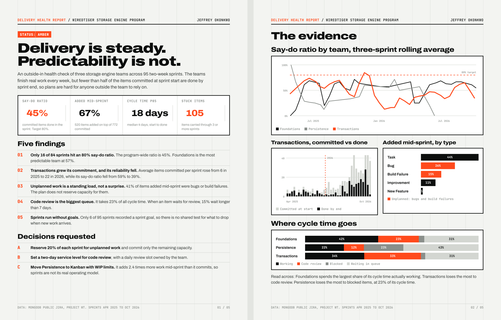

# Delivery Health Report

**An outside-in delivery health check of a real engineering program: three MongoDB storage engine teams, 95 two-week sprints, 2,943 public Jira tickets, April 2025 to October 2026.**

**Watch the 60-second Power BI walkthrough:** [assets/Delivery_Health_PowerBI.mp4](assets/Delivery_Health_PowerBI.mp4)

[Read the 5-page report (PDF)](reports/Delivery_Health_Report.pdf) · [Excel model](excel/Delivery_Health_Model.xlsx) · [Power BI project](powerbi/) · [Python pipeline](pipeline/)

## The question

If I joined this program as its delivery manager tomorrow, what would the data tell me in week one, and what would I do about it?

## What the data says

| Measure | Result |
|---|---|
| Say-do ratio (committed items done in the sprint) | **45%** program-wide. Only 16 of 84 sprints reached 80% |
| Work added mid-sprint | **520** items on top of 772 committed (67%) |
| Unplanned share of added work | **41%** were bugs or build failures |
| Cycle time, start to done | median **4 days**, 85th percentile **18 days** |
| Code review share of cycle time | **23%** overall, 33% for the Transactions team |
| Items carried through 3 or more sprints | **105** (23 through 5 or more) |
| Sprints with a written goal | **6 of 95** |

The sharpest finding: the Transactions team raised its average commitment from about 6 items a sprint in 2025 to 22 in 2026, and its say-do ratio fell from 59% to 39%.

## What I would do

The report ends with a RAID log and a 90-day recovery plan: hold 20% of capacity for unplanned work, set a two-day code review service level, give every sprint a goal, triage the stuck items, and move the team that adds more work than it commits to Kanban with WIP limits. Targets at day 90: say-do ratio of 70% or more, scope added under 30%, and an 85th percentile cycle time under 12 days.

## How it was built

1. **Extract** (`pipeline/fetch.py`): every WiredTiger ticket that sat in a sprint and changed after January 2025, with full status and sprint history, from MongoDB's public Jira REST API.
2. **Rebuild commitment** (`pipeline/parse.py`, `pipeline/metrics.py`): sprint membership is reconstructed from each ticket's history, so "committed" means in the sprint two hours after it started, not whatever was left at the end.
3. **Measure**: say-do ratio, scope added, carry-over, cycle time, time in each status, weekly throughput and cumulative flow.
4. **Model**: Excel workbook with live formulas and a capacity planner; Power BI star schema with DAX measures over the same CSV files.
5. **Report** (`pipeline/report.py`): every number in the PDF is generated from the data files.

## Limits

This is an outside-in read of public tickets. It does not see holidays, on-call duty, people moving between teams or work outside Jira, and many open-source teams use sprints as a planning rhythm rather than a promise. A low say-do ratio is a question to ask the team, not a verdict on the people. No individual is named or scored.

*Data: MongoDB public Jira, project WT (WiredTiger). Built by Jeffrey Okonkwo.*
