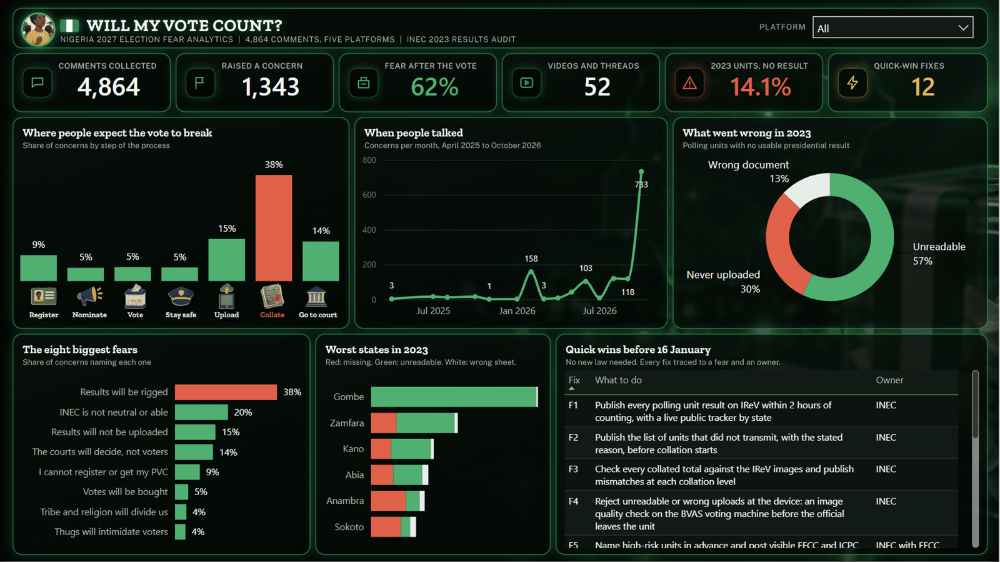
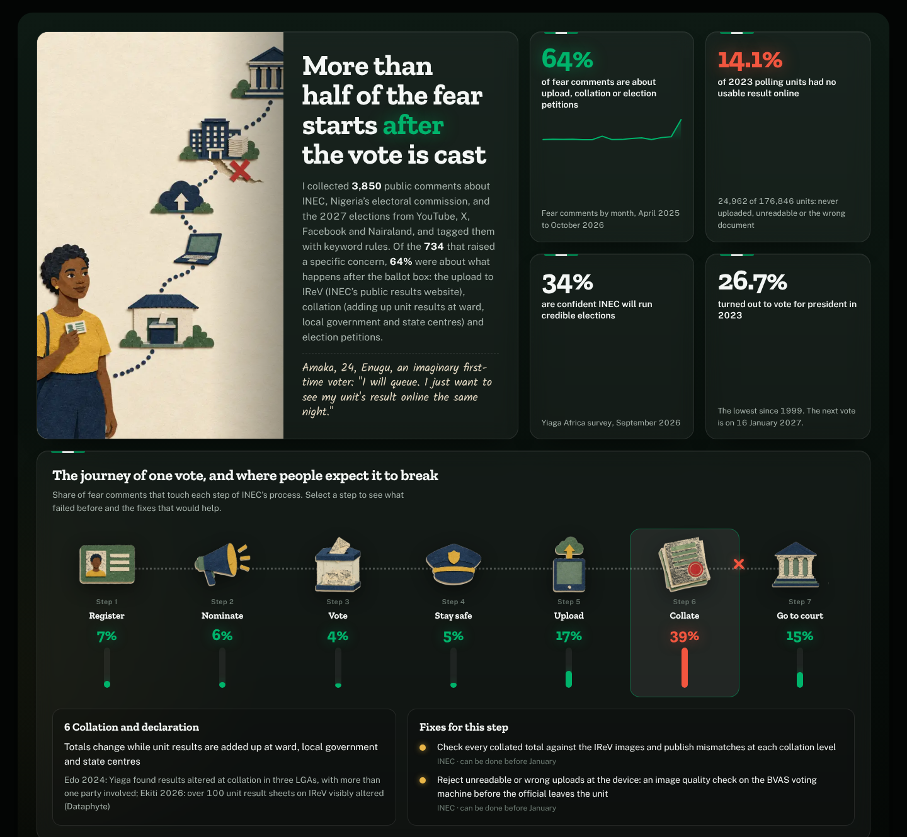
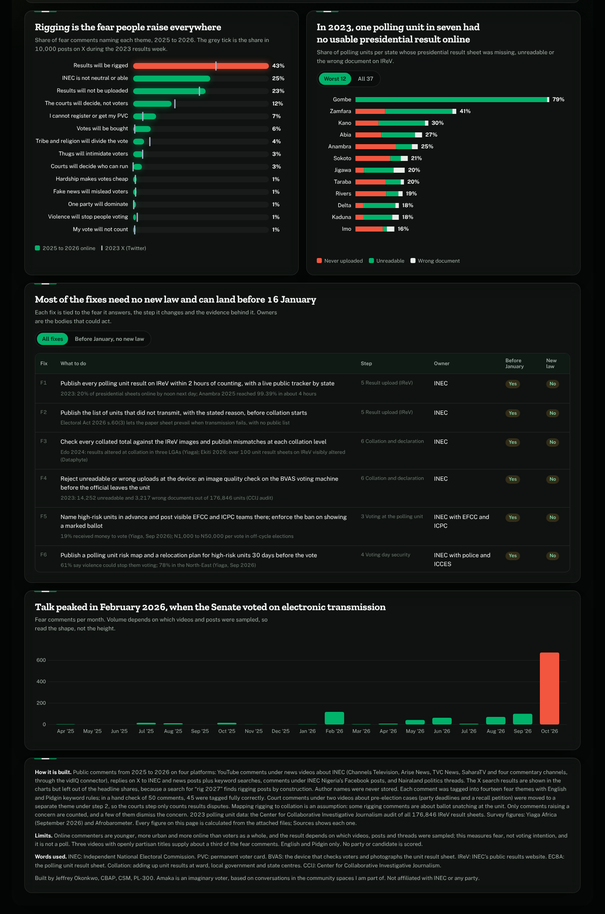

# Will My Vote Count?

**What Nigerians fear about the 2027 election, mapped to the step of INEC's process where each fear lives, checked against 2023 data, with fixes that could land before the vote.**


Nigeria votes for president on **16 January 2027**. Only 34% of Nigerians surveyed are confident that INEC, the Independent National Electoral Commission, will run a credible election (Yiaga Africa, September 2026), and turnout fell to 26.7% in 2023, the lowest since 1999.
I wanted to know which steps of the process people actually fear, whether those fears have a basis, and what could be fixed in time.

**Watch the 40-second Power BI walkthrough:** [assets/Will_My_Vote_Count_PowerBI.mp4](assets/Will_My_Vote_Count_PowerBI.mp4)
**Try the dashboard:** download [`dashboard.html`](dashboard.html) and open it in any browser (data built in).
**Open the Power BI report:** [`powerbi/POWERBI_GUIDE.md`](powerbi/POWERBI_GUIDE.md)

## The answer in three lines

| Finding | Evidence |
|---|---|
| **Nearly two thirds of the fear (62%) is about what happens after the ballot box**: the upload, the collation and election petitions | 4,864 public comments from YouTube, X, Instagram, Facebook and Nairaland; 1,343 raised a specific concern, 855 of them under posts and videos rather than keyword searches; rigging (mapped to collation) 38%, upload 15%, post-election courts 14% |
| **The fear has a basis** | In 2023, **1 in 7 polling units (14.1%)** had no usable presidential result on IReV, INEC's public results website (CCIJ audit): 7,493 never uploaded, 14,252 unreadable, 3,217 the wrong document |
| **Most fixes need no new law** | 12 of the 15 proposed fixes could be in place before 16 January 2027 |

## Power BI report



Five pages, a star schema and DAX measures, loading straight from this folder. Open it with [`powerbi/POWERBI_GUIDE.md`](powerbi/POWERBI_GUIDE.md).

## The journey of one vote



| Step | Share of fear comments | What failed before |
|---|---|---|
| 1 Register and collect a permanent voter card (PVC) | 9% | 6,259,229 cards uncollected in 2023 |
| 2 Parties and candidates | 5% | Party disputes and pre-election cases settled by courts and INEC recognition |
| 3 Vote at the polling unit | 5% | Officials at 27% of units by 7:30 a.m. in 2023 |
| 4 Stay safe on the day | 5% | 61% say violence could stop them voting |
| 5 Upload to IReV, the public results website | 15% | 20% of presidential sheets online by noon the next day |
| 6 Collation (adding up unit results) and declaration | **38%** | Edo 2024: Yiaga found results altered at collation, with more than one party involved; Ekiti 2026: over 100 unit result sheets visibly altered (Dataphyte) |
| 7 Petitions and tribunals | 14% | Supreme Court (2023): IReV is a viewing portal, not a collation centre, and a failed upload alone does not void a result |

## Fixes (the business analysis deliverable)

A traceability matrix links each fear theme to the process step, the evidence, a fix and an owner. The top three, all for INEC, all possible before January with no new law:

1. Publish every polling unit result on IReV within two hours of counting, with a live public tracker by state.
2. Check every collated total against the uploaded sheets and publish each mismatch at every collation level.
3. Reject unreadable or wrong uploads at the device, before the presiding officer leaves the unit.

The full list of 15, with owners and evidence, is in [`data/fixes.csv`](data/fixes.csv) and the Fixes tab of the workbook.



## How it is built

```
Public comments on five platforms                CCIJ audit of every 2023 IReV result sheet
4,864 comments: YouTube (vidIQ connector),       176,846 polling units
X, Instagram, Facebook and Nairaland (read
in a browser, no names stored)
        |                                                 |
        v                                                 v
pipeline/themes.py    14 fear themes, English and Pidgin rules, each mapped to an INEC step
pipeline/analyse.py   tag, tone (VADER + Nigerian lexicon), 2023 baseline from 10,000 posts on X
pipeline/pu_2023.py   result sheet status by state
        |
        +--> dashboard.html                 journey, fear themes, 2023 evidence, fixes table
        +--> excel/Will_My_Vote_Count.xlsx  live COUNTIF and SUMPRODUCT model, step picker
        +--> powerbi/                        star schema, DAX measures, theme, Power Query from this repo
```

| Skill shown | Where |
|---|---|
| Problem framing and requirements | One question, seven process steps, one decision per view |
| Process analysis | INEC value stream with pain points per step ([`research/inec_process.md`](research/inec_process.md)) |
| Text analytics | Rule-based theme tagging in English and Pidgin across five platforms; 45 of 50 comments tagged fully correctly in a hand check |
| Data modelling | Star schema in `powerbi/` |
| Traceability | Fear to step to evidence to fix to owner |
| Visual storytelling | Cut-paper character art, one red mark for the broken step |

## Notes and limits

- **Not a poll.** Online commenters lean younger, more urban and more online than voters as a whole, and the result depends on which videos, posts and threads were sampled. This measures fear, not voting intention.
- **Volume.** 1,343 comments raised a concern, and a few of them dismiss it. Keyword searches on X (for example "rig 2027") find matching posts by construction, so the 488 search results are shown in the explorer but left out of the headline shares, which rest on the 855 comments found under posts and videos. Breadth matters more than count: rigging appears under 42 of the 52 videos and threads.
- **Mapping.** Rigging is mapped to collation, although some rigging comments are about ballot snatching at the unit. Court comments under two videos about pre-election cases (party deadlines and a recall petition) are counted under step 2, not step 7.
- **Source mix.** Nairaland (354) and YouTube (291) supply most of the headline comments, then Instagram (121), X (62) and Facebook (27). Three YouTube videos with openly partisan titles supply about a third of the YouTube share.
- **English and Pidgin only.** Hausa, Yoruba and Igbo discussion is not covered.
- **Nonpartisan.** No party or candidate is scored.
- **Privacy.** Author names and handles were never stored. Comment text is not published, in line with the platforms' terms; `data/fears.csv` holds only tags, month, channel and tone.

## Words used

INEC: Independent National Electoral Commission. PVC: permanent voter card. BVAS: the device that checks voters and photographs the unit result sheet. IReV: INEC's public results website. EC8A: the polling unit result sheet. Collation: adding up unit results at ward, local government and state centres. CCIJ: Center for Collaborative Investigative Journalism.

## Sources

INEC; Center for Collaborative Investigative Journalism, nigeria-2023-election (GitHub); Yiaga Africa voting intentions survey (September 2026); Afrobarometer Round 10; EU Election Observation Mission, Nigeria 2023; Situation Room; Dataphyte; Kaggle, twitter-data-nigerian-2023-presidential-election. Full citations with dates are in [`research/`](research/).

Amaka is an imaginary first-time voter, based on conversations in the community spaces I am part of. Not affiliated with INEC or any party.

Built by **Jeffrey Okonkwo**, Senior Business Analyst and Agile Delivery Manager, CBAP, CSM, PL-300.
